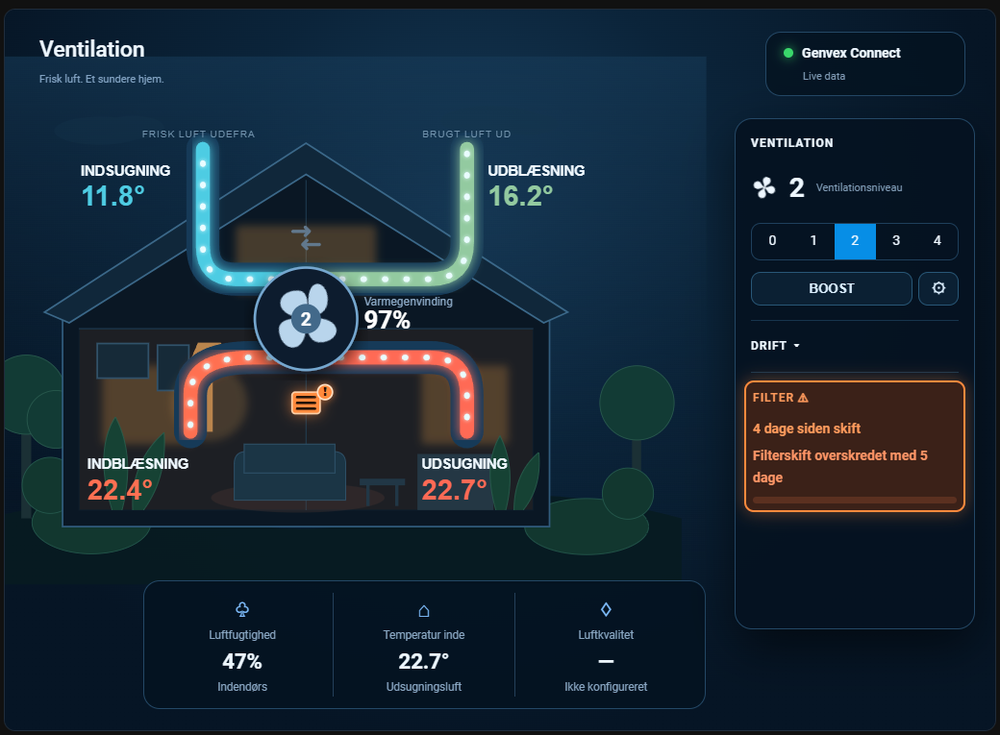
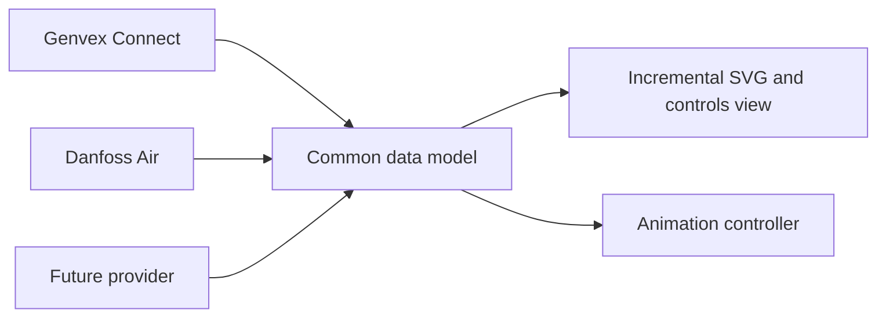

# Ventilation Flow Card

[](https://github.com/MEbsen/GenvexFlowCard/actions/workflows/validate.yml)
[](https://hacs.xyz/docs/faq/custom_repositories/)
[](https://www.home-assistant.io/)
[](LICENSE)
[](https://buymeacoffee.com/mebsen)

A responsive, animated Home Assistant dashboard card for heat-recovery ventilation systems. Ventilation Flow Card turns ventilation entities into a visual representation of the house, airflow, temperatures, heat recovery and the controls supported by the selected system.

The card started as Genvex Flow Card and has evolved into a provider-based card. Existing Genvex configurations remain compatible.

> **Unofficial project:** Ventilation Flow Card is an independent community project. It is not affiliated with, endorsed by, or sponsored by Genvex, Danfoss or other ventilation manufacturers.

## Preview



*Genvex Connect shown. The controls and status information displayed by the card depend on the capabilities exposed by the selected Home Assistant integration.*

## Highlights

- Animated four-way airflow visualization.
- Temperature-driven airflow colours.
- Heat-recovery efficiency display.
- Fan speed visualization and control where supported.
- Fan RPM display and smooth animation driven by normalized fan speed.
- Boost control with speed/duration settings when exposed by the provider.
- Bypass status and control where supported.
- Filter status, warning and reset handling.
- Humidity and operating-status information.
- Provider-based architecture for multiple ventilation integrations.
- Visual Home Assistant card editor.
- Responsive SVG layout.
- Existing `custom:genvex-flow-card` configurations remain supported.

## Supported providers

| Provider | Status | Fan control | Boost | Bypass | Filter | RPM |
| --- | --- | --- | --- | --- | --- | --- |
| Genvex Connect | Supported | Steps | Yes | When exposed | Days / calculated fallback | When exposed |
| Danfoss Air | Experimental | 0–100% | Yes | Yes | Remaining % | Supply / exhaust |
| Generic | Explicit entity mapping | Steps / continuous | When mapped | When mapped | Days / % | When mapped |

Support depends on the entities and capabilities exposed by the Home Assistant integration and the ventilation unit itself.

The provider architecture is designed so additional systems can be added by mapping their Home Assistant entities and capabilities rather than implementing a separate card UI.

### Generic systems and fan ranges

Use `provider: generic` and explicit entity mappings to add an integration without changing SVG graphics or animations. Fan configuration also works with existing providers. Numeric state values are normalized from `min`–`max` to 0–100% for animation; RPM is displayed separately, without assuming every unit has the same maximum RPM.

```yaml
type: custom:genvex-flow-card
provider: generic
entities:
  temp_outside: sensor.unit_outside_temperature
  temp_supply: sensor.unit_supply_temperature
  temp_extract: sensor.unit_extract_temperature
  temp_exhaust: sensor.unit_exhaust_temperature
  humidity: sensor.unit_humidity
fan:
  entity: number.unit_speed
  mode: percentage
  min: 0
  max: 1
  step: 0.05
```

For steps 0–5, use `mode: steps`, `min: 0`, `max: 5`, `step: 1` and the integration's select or number entity. Select options are read from the entity; numeric options also supply the default range. For active steps 1–5, `min: 1` does not imply that step 1 is off: its normalized speed is 20%. Numeric speeds use zero as their default off reference; an explicit numeric `off_value` supplies another reference. Positive minimums remain active speeds.

Named options can be supplied with `options: ["off", low, medium, high]`. Active options are ordered from slowest to fastest and evenly spaced by default. Use `option_values` for unequal speeds:

```yaml
fan:
  entity: select.unit_speed
  mode: steps
  min: 0
  max: 100
  options: ["off", low, medium, high]
  option_values:
    "off": 0
    low: 15
    medium: 45
    high: 100
  off_values: ["off"]
```

Use `attribute: speed` when the current value is in an attribute, or `running_entity: binary_sensor.unit_running` for an independent operating state. An unavailable operating-state entity makes running status unknown and pauses animation. Fan entities automatically use `percentage` and `percentage_step` and require a 0–100 range; number entities use their `min`, `max` and `step` attributes unless overridden. Sensor entities provide display without controls. Unknown or unavailable speed values show `—`; unavailable entities disable their controls. Home Assistant fan percentage commands always use the 0–100 scale.

The shared fan model handles normalization and service dispatch; provider adapters handle discovery and integration-specific actions. Unchanged normalized data skips rendering. Changed data is reconciled into existing DOM nodes, preserving animation timelines, input focus and open panels. The animation controller eases playback-rate changes without restarting the timeline; newly added airflow paths share the existing airflow phase. Reduced-motion preferences pause all motion. On narrow cards, the **Betjening** button exposes the available controls.

## Requirements

- Home Assistant with a supported ventilation integration.
- At least one supported provider available in Home Assistant.
- JavaScript modules enabled for Lovelace resources.

Ventilation Flow Card communicates only with Home Assistant. It does not connect directly to the physical ventilation unit.

## Installation with HACS

[](https://my.home-assistant.io/redirect/hacs_repository/?owner=MEbsen&repository=GenvexFlowCard&category=plugin)

Use the button above for one-click setup, or add it manually:

1. Open **HACS → Frontend**.
2. Open the menu and choose **Custom repositories**.
3. Add `https://github.com/MEbsen/GenvexFlowCard`.
4. Select category **Dashboard** and add the repository.
5. Install **Ventilation Flow Card**.
6. Reload Home Assistant in the browser.

HACS normally creates the Lovelace resource automatically. If it does not, add:

```text
/hacsfiles/GenvexFlowCard/genvex-flow-card.js
```

Resource type: **JavaScript module**.

## Card configuration

Add **Custom: Ventilation Flow Card** from Home Assistant's card picker and select the integration/provider in the visual editor.

### YAML example

```yaml
type: custom:genvex-flow-card
title: Ventilation
height: 720
provider: genvex_connect
```

The historical card type `custom:genvex-flow-card` is intentionally retained for backwards compatibility.

| Option | Type | Default | Description |
| --- | --- | --- | --- |
| `type` | string | required | Must remain `custom:genvex-flow-card`. |
| `provider` | string | `genvex_connect` | `genvex_connect`, `danfoss_air` or `generic`. |
| `ventilation_entity` | string | auto / optional | Entity used to anchor provider discovery when applicable. |
| `genvex_entity` | string | legacy / optional | Existing Genvex configurations remain supported. |
| `entities` | object | optional | Common entity mappings; explicit mappings override discovery and legacy mappings. |
| `fan` | object | optional | Fan entity, mode, range, step, attribute and optional option/off/running mappings. |
| `auto_option` | string | optional | Explicit AUTO option for Danfoss when its label is not `auto` / `automatic`. |
| `debug_boost` | boolean | `false` | Show the resolved Boost entity/state and last action result. |
| `debug_bypass` | string | optional | `open` or `closed` simulates the displayed bypass route only. |
| `filter_interval_days` | number | `-1` | `-1` or empty uses the integration's days/months interval. A positive value overrides it. |
| `title` | string | `Ventilation` | Card title. |
| `height` | number | `720` | Rendered card height in pixels. |

## How providers work

See [Architecture and provider contract](docs/architecture.md) for responsibilities, design patterns and extension/testing guidance.



A provider maps the entities exposed by a Home Assistant ventilation integration to common card capabilities such as:

- outside, supply, extract and exhaust temperatures;
- fan status and fan control;
- supply and exhaust RPM;
- boost and optional boost settings;
- bypass;
- filter state;
- humidity, defrost, heating and other operating states.

The model normalizes entity references, values, capabilities and actions. For example, Genvex exposes fan speed as steps while Danfoss Air exposes a percentage; both use the same fan model. Fan configuration preserves Danfoss AUTO/OFF actions. Measurements and derived efficiency/filter values are normalized before rendering, including conversion of Fahrenheit temperatures to Celsius.

Each feature distinguishes `supported` (mapped), `available` (known current data), its value and permitted actions. Unsupported control/status sections are omitted; supported but unavailable values show `—` and their actions are disabled. Temperature positions remain part of the shared airflow diagram and show `—` when no measurement is available. Filter percentage, warning, details and reset confirmation use the same component as day-based filters.

The active provider and card version are shown in the card and in the visual editor. This makes screenshots and issue reports easier to identify.

The architecture uses provider adapters, a provider factory/registry, a normalized view model and separate view/animation controllers. Providers never patch the card's prototype or access its DOM. The factory and visual editor use the same provider definitions. User disclosure state is separate from integration state; UI handlers use the latest model rather than callbacks bound to an earlier data update.

To implement an integration, extend `VentilationProviderAdapter`, implement `resolve(key, domain)` with entity discovery/mapping and optionally extend actions in `fanModel`. Register the adapter once using `registerProvider({id, name, Adapter, experimental})` in `src/providers/index.js`. Add provider contract fixtures; no changes to graphics, animation or editor provider lists are required. Explicit mapping with `provider: generic` needs no new adapter.

Genvex and Danfoss discovery share device scoping. `ventilation_entity` anchors discovery to its registered device. Without an anchor, ambiguous matches are left unresolved, preventing states and commands from different units from being combined. Explicit `entities` mappings intentionally bypass automatic discovery.

## Genvex Connect

Genvex Connect remains fully backwards compatible with the original Genvex Flow Card.

The card can use the integration's fan level, temperatures, operating states, boost, fan RPM and filter entities. Filter warnings use `filter_days_left` directly when available. With `filter_interval_days: -1` (the default), the service interval is read from Genvex Connect in days or months; a positive configured value overrides the integration.

On CTS400 systems running Genvex Connect 1.5.4 or newer, the card exposes the available humidity threshold, low/high humidity fan levels and high-humidity timeout behind a compact **Fugtstyring** settings button. The button is omitted on systems that do not expose these capabilities.

## Danfoss Air

Danfoss Air support includes automatic entity discovery for the supported Home Assistant entities, percentage fan control, AUTO/OFF operation, Boost, writable bypass, remaining-filter percentage and supply/exhaust RPM when those entities are exposed.

The exact feature set can vary with the unit and Home Assistant integration.

## Troubleshooting

### The card is not listed

- Confirm that the repository was added to HACS as category **Dashboard**.
- Confirm that `genvex-flow-card.js` exists as a JavaScript module resource.
- Reload the browser without cache after installing or updating.

### The old version is still shown

1. Select **Redownload** on the Ventilation Flow Card page in HACS.
2. Reload Home Assistant without browser cache.
3. Check the version written to the browser console by Ventilation Flow Card.

### A control or value is missing

The card only shows capabilities it can resolve from the selected provider. Confirm that the relevant entity exists, is enabled and is available in Home Assistant. With multiple units, select an anchor entity from the intended device or provide explicit mappings. Supported but temporarily unavailable values show `—`.

When reporting a provider mapping problem, include the card version and the relevant entity IDs/states.

## Development

Stable code lives on `main`; active development lives on `dev`.

The distributed HACS resource is a single standalone JavaScript file, while provider implementations are maintained as modules under `src/providers/`.

```bash
npm install
npx playwright install chromium
npm run check
```

The check command runs model/provider/animation tests, builds the standalone bundle, validates its syntax and registration, and runs real-browser regression tests. Browser tests cover DOM/animation identity, unchanged data, bypass changes, reduced motion, input focus, service commands, filter reset and editor configuration. On a machine with Edge already installed, set `PLAYWRIGHT_CHANNEL=msedge` to use it instead of downloading Chromium. CI installs Chromium before running these checks. Browser test fixtures do not connect to a physical ventilation unit.

### Automated releases

Development prereleases are created automatically from `dev`. Stable releases are created from `main`: finish and validate all changes, update `VERSION`, and make the final version commit with the exact message `Release vX.Y.Z`. `VERSION` is the single source used by the build, card, editor and release workflows; compiled JavaScript is validated without version rewriting.

GitHub Actions then builds and smoke-tests the standalone card, validates HACS compatibility, creates the matching tag and publishes both `genvex-flow-card.js` and `genvex-flow-card.zip`. Existing tags are never overwritten.

Pull requests, provider contributions and reproducible bug reports are welcome.

## Roadmap

- Add more ventilation providers using the common capability model.
- Add fixtures for more integration versions and physical devices.
- Extend discovery metadata mappings where integrations expose additional entity conventions.
- Add additional screenshots as provider implementations are validated.

## Support

If Ventilation Flow Card is useful to you, you can support its continued development by [buying me a coffee](https://buymeacoffee.com/mebsen).

Contributions are entirely optional; the card remains free and open source.

## Trademark notice

Ventilation Flow Card is an independent, unofficial open-source project and is not affiliated with, endorsed by, or sponsored by Genvex, Danfoss or other ventilation manufacturers. Product and company names are trademarks of their respective owners and are used only to describe compatibility.

## License

[MIT](LICENSE)
