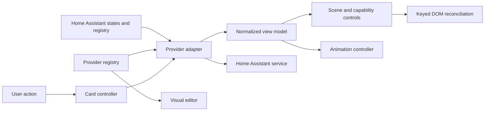

# Provider and rendering architecture

The ventilation scene is shared by all integrations. Integration code maps entities and actions; it does not own the SVG, UI components or animations.

## Responsibilities and patterns

| Component | Responsibility | Pattern / method |
| --- | --- | --- |
| `providers/index.js` | Register integration metadata and create the selected adapter; supply editor choices | Registry, Factory, provider selection as Strategy |
| `providers/base.js` and subclasses | Discover entities, scope them to a device, map legacy configuration and execute integration actions | Adapter; shared discovery and actions |
| `fan-model.js` | Normalize numeric/named fan scales and expose validated fan commands | Shared model and action boundary |
| `ventilation-model.js` | Normalize measurements, availability, binary states, derived efficiency and filter status | Presentation Model; pure transformation |
| `ventilation-flow-card.js` | Coordinate configuration, updates, disclosure state, lifecycle and user actions | Controller; composition of provider, view and animation components |
| `card-view.js`, `controls-view.js`, `card-scene.js` | Render the common scene and controls supported by the model | View; capability-driven rendering and delegated events |
| `dom-patch.js` | Update attributes/text while preserving node identity, focus and scrolling | Incremental DOM reconciliation |
| `animation-controller.js` | Own timelines, smooth playback rates, reduced motion and cleanup | Lifecycle-managed animation controller |
| `card-editor.js` | Edit common configuration using registry metadata | Shared metadata; separation of editor and runtime view |

There are no provider-installed prototype patches, deferred registration hooks or provider-owned DOM mutations. Only the adapter/action boundary calls Home Assistant services. The view receives normalized data and does not inspect raw Home Assistant state strings.

## Model contract

`supported` means that a feature has an entity mapping. `available` means its current state can be interpreted. Unknown values are represented by `null`, not a fabricated zero or `false`. Writable actions require an available entity and a supported service domain. Derived efficiency and filter values are calculated before rendering.

The fan also distinguishes `speedAvailable` and `running`. A fan may have a known running state but no readable percentage. An explicit `running_entity` may supply running status independently of the speed setting. Missing/unavailable running status pauses animation. An active positive minimum (for example step 1 of 5) has a positive normalized speed. Named options support unequal `option_values` and explicit `off_values`.

Configured numeric/select scales normalize to 0–100 for animation; service commands remain in the integration's native number/select scale. Home Assistant `fan` entities use percentage commands and require a 0–100 range. Sensor speed mappings remain read-only.

## Discovery

Explicit mappings take precedence over discovery and legacy mappings. With `ventilation_entity` (or legacy `genvex_entity`), registry device identity scopes discovery for both built-in integrations. Within that scope, translation/unique-ID metadata is preferred, followed by known IDs/friendly names. Ambiguous matches return no mapping. A configured anchor that cannot be resolved never falls back to another device.

Discovery is refreshed when the configured anchor changes. Home Assistant state updates are read live; newly created registry devices may require selecting an anchor or reloading the card. Explicit generic mappings require no registry discovery.

## Rendering and motion

The card compares normalized model/configuration/UI state before rendering. Unrelated state changes do not rewrite the DOM. Changed data updates existing nodes. Stable keys preserve the fan rotor and airflow paths even when the bypass route changes. Event delegation is installed once; commands always use the current model.

Animations use fixed, repeating Web Animations timelines. Speed changes adjust playback rates with a short exponential ease, preserving current time. New airflow paths inherit the existing airflow timeline phase. Pausing, reduced motion and card removal are handled separately from speed normalization. Only rate transitions use `requestAnimationFrame`; steady motion runs on browser animation timelines.

UI disclosure/confirmation state is separate from integration state. Filter percentage does not replace the filter component or remove reset confirmation. Narrow cards expose available controls through a toggle. Switching providers in the editor clears mappings/scales belonging to the previous integration.

## Adding an integration

For ordinary number/select/fan entities, use `provider: generic`, entity mappings and a fan range. For automatic discovery or integration-specific operations, extend `VentilationProviderAdapter`, implement `resolve(key, domain)` and optionally extend actions while preserving the shared fan model. Register the adapter and metadata once. Add fixtures covering available, unavailable, off, partial capabilities and multiple devices. The SVG, animation controller and editor provider list need no changes.

## Verification

`npm run check` stops at the first failure and runs fan-model tests, provider contract/discovery/rendering tests, animation-controller tests, bundle build/syntax/registration checks and browser regression tests. Browser tests verify DOM/animation identity, skipped irrelevant updates, bypass changes, service payloads, focused inputs, filter confirmation, editor changes, reduced motion and disconnect/reconnect.

These tests use fixtures. Actual integration entity conventions and physical unit behavior still need Home Assistant testing.
